# MarkTypo - 极简高颜值本地 Markdown 编辑器项目开发与架构设计文档

> **项目定位**：一款专为个人高效写作打造的免费、轻量、高颜值的 Typora 风格 Markdown 编辑器。专注于**真·所见即所得（Seamless WYSIWYG）**编辑体验、数学公式与图表即时渲染、本地工作区管理与多格式无缝导出。

---

## 1. 项目背景与痛点分析

### 1.1 痛点分析
1. **商业收费**：经典编辑器 Typora 已转向买断/订阅制收费，个人自用缺乏纯粹、轻量、免费的优质替代品。
2. **传统双栏编辑器的割裂感**：左边 Markdown 源码、右边 HTML 预览的双栏布局严重分散注意力，占用双倍屏幕空间。
3. **重型工具的繁冗复杂度**：Obsidian、Logseq 等虽然生态丰富，但插件配置繁琐、启动缓慢，缺乏像 Typora 那样“双击 md 文件即开即写、清爽无扰”的极致体验。
4. **隐私与离线需求**：在线 Markdown 笔记工具存在数据泄露风险或网络依赖，个人写作者更倾向于本地纯文本 `.md` 文件的完全掌控权。

### 1.2 核心目标
- **完全免费、离线私密**：数据纯本地存储，无任何云端依赖与遥测追踪。
- **真·所见即所得**：输入 Markdown 语法后自动隐式渲染，光标在位时即可直接编辑，无缝流畅。
- **开箱即用的大纲与文件树**：支持打开本地文件夹、目录树展开折叠、大纲标题实时索引与快速跳转。
- **全格式支持**：GFM 语法、数学公式 (LaTeX/KaTeX)、代码高亮、Mermaid 图表、可视化表格、待办清单。
- **双端支持**：既可通过现代浏览器 File System Access API 实现零安装极速使用，也支持作为 Electron 桌面端原生运行。

---

## 2. 系统功能架构与特性清单

```mermaid
graph TD
    A[MarkTypo Markdown 编辑器] --> B[核心编辑引擎 WYSIWYG]
    A --> C[工作区与文件管理]
    A --> D[排版渲染与扩展组件]
    A --> E[导出与互操作]
    A --> F[沉浸交互与个性化]

    B --> B1[所见即所得实时渲染]
    B --> B2[源码模式 / WYSIWYG 一键切换]
    B --> B3[Typora 兼容快捷键系统]
    B --> B4[撤销 / 重做与历史记录]

    C --> C1[本地文件夹树与文件浏览]
    C --> C2[多标签页 Multi-Tab 编辑]
    C --> C3[文档大纲 TOC 实时提取与锚点定位]
    C --> C4[自动保存与未保存修改提示]

    D --> D1[GFM 可视化交互表格]
    D --> D2[LaTeX / KaTeX 数学公式渲染]
    D --> D3[Highlight.js 代码块与语法高亮]
    D --> D4[Mermaid 流程图 / 时序图]
    D --> D5[交互式任务列表 Todo List]

    E --> E1[一键导出独立自包含 HTML]
    E --> E2[一键打印 / 导出为 PDF]
    E --> E3[原生 .md 文件读写与另存为]

    F --> F1[多套主题: Github浅色 / Night暗黑 / Sepia复古]
    F --> F2[专注模式 Focus Mode]
    F --> F3[打字机模式 Typewriter Mode]
    F --> F4[底部状态栏: 字数/行数/阅读时间统计]
```



### 2.1 详细功能矩阵

| 功能模块 | 核心能力 | 实现说明 |
| :--- | :--- | :--- |
| **所见即所得编辑** | 标题、粗体、斜体、删除线、行内代码、引用块、分割线 | 基于 ProseMirror/TipTap 架构，输入 Markdown 快捷标记自动转换，在位排版 |
| **源码/WYSIWYG 切换** | `Ctrl+/` 快捷键极速切换 | 支持直接查看编辑 Raw Markdown，两端数据双向无损同步 |
| **表格可视化交互** | 行列增删、合并单元格、Tab 跳转 | 表格悬浮操作条，支持快捷增加行/列、删除行/列、表头切换 |
| **数学公式 (LaTeX)** | 行内公式 `$x$` 与独占块公式 `$$\sum$$` | 集成 KaTeX 引擎，实时预览公式，双击/聚焦即时修改 LaTeX 源码 |
| **代码高亮与行号** | 支持 50+ 编程语言高亮，一键复制代码 | Highlight.js 语法分析，支持语言下拉切换、格式化与行号显示 |
| **Mermaid 图表** | ````mermaid` 自动识别绘图 | 支持流程图 (graph/flowchart)、时序图 (sequenceDiagram)、甘特图、类图 |
| **任务清单** | `- [ ]` 与 `- [x]` | 交互式复选框，直接点击完成勾选，实时同步回 Markdown 文本 |
| **本地文件工作区** | 打开本地文件夹、展开收起、新建/重命名/删除 | 现代 Web File System Access API + 本地安全沙箱，支持读取本地多级目录 |
| **文档大纲 (TOC)** | 自动提取文档内 H1~H6 标题 | 树状层级显示，点击平滑滚动定位到对应位置，高亮当前视口标题 |
| **多标签页 (Tabs)** | 打开多个文件自由切换，关闭未保存防丢失提醒 | 类似浏览器/VS Code 的标签页交互，快速在多个文档间协同编辑 |
| **导出能力** | 导出带样式的 HTML、导出 PDF、另存为 | 内置完整排版 CSS 样式，HTML 单文件直接分享无样式丢失 |
| **主题与专注体验** | Github 经典、Night 极夜黑、Sepia 护眼羊皮纸 | 纯 CSS 变量驱动，支持打字机居中滚动、F11 全屏专注写作 |

---

## 3. 技术选型与架构设计

### 3.1 技术栈选型

| 层次 | 选型 | 理由与考量 |
| :--- | :--- | :--- |
| **构建与语言** | Vite + React 19 + TypeScript | 极速冷启动、HMR 热重载、强类型保障代码健壮性 |
| **样式系统** | Tailwind CSS + Lucide React | 现代化原子级样式、极度轻量、图标风格精致统一 |
| **富文本核心** | TipTap v2 (基于 ProseMirror) | 业界最成熟的 Headless 富文本引擎，拥有强大的 AST 扩展机制与文档驱动模型 |
| **Markdown 序列化** | `tiptap-markdown` + 扩展解析器 | 双向双通道无损解析：Markdown 文本 ⇋ ProseMirror JSON ⇋ WYSIWYG DOM |
| **数学公式渲染** | KaTeX | 渲染速度远超 MathJax，轻量级，支持绝大多数常见 LaTeX 数学符号与宏 |
| **图表渲染** | Mermaid.js | 现代开源图表标准，支持纯文本绘制流程图、序列图、状态机等 |
| **代码语法高亮** | Highlight.js | 纯本地无依赖，无需外链 CDN，覆盖主流常用编程语言 |
| **底层平台支持** | Web File System API + Electron 兼容层 | 优先利用浏览器原生文件系统能力降低使用门槛，同时无缝支持打包为 Windows 桌面端 `.exe` |

### 3.2 核心数据流设计

```
[本地磁盘 .md 文件]
       │
       ▼ (File System API / Node fs)
[Markdown 纯文本原始数据]
       │
       ├──────────────────────────────────────────┐
       │ (tiptap-markdown parser)                 │ (Source Mode)
       ▼                                          ▼
[TipTap / ProseMirror Document AST]      [Source Code Editor]
       │                                          ▲
       │ (Interactive Rendering)                  │ (Ctrl + /)
       ▼                                          │
[WYSIWYG 所见即所得编辑界面] ──────────────────────┘
       │
       ▼ (Serializer & Export Engine)
[导出 HTML / PDF / 实时保存至磁盘 .md]
```

---

## 4. 目录结构规范

```
md/
├── public/                     # 静态资源 (图标、模板等)
├── src/
│   ├── assets/                 # 样式表与字体
│   │   └── editor.css          # TipTap 排版主题样式 (Github, Dark, Sepia)
│   ├── components/             # UI 与业务组件
│   │   ├── Editor/             # 编辑器核心组件
│   │   │   ├── TipTapEditor.tsx      # 所见即所得核心
│   │   │   ├── SourceEditor.tsx      # 源码模式编辑器
│   │   │   ├── BubbleMenu.tsx        # 划词浮动格式化栏
│   │   │   ├── TableControls.tsx     # 表格操作快捷悬浮工具
│   │   │   ├── MathNodeView.tsx      # KaTeX 公式块节点渲染
│   │   │   └── MermaidNodeView.tsx   # Mermaid 图表节点渲染
│   │   ├── FileExplorer/       # 本地文件管理器边栏
│   │   │   ├── FileTree.tsx          # 目录树递归组件
│   │   │   └── FileItem.tsx          # 单个文件/文件夹项
│   │   ├── Outline/            # 大纲目录 TOC 组件
│   │   │   └── DocumentOutline.tsx   # 提取标题并平滑跳转
│   │   ├── TabBar/             # 多标签页管理器
│   │   │   └── TabBar.tsx            # 标签切换、新增、关闭
│   │   ├── Toolbar/            # 顶部操作与格式化工具栏
│   │   │   └── Toolbar.tsx           # 常用操作快捷入口
│   │   ├── StatusBar/          # 底部状态栏
│   │   │   └── StatusBar.tsx         # 字数统计、编码、模式指示
│   │   └── Modals/             # 弹窗组件
│   │       ├── ExportModal.tsx       # HTML/PDF 导出对话框
│   │       ├── SettingsModal.tsx     # 主题、字体等设置
│   │       └── ShortcutsModal.tsx    # 快捷键速查表
│   ├── hooks/                  # 自定义 React Hooks
│   │   ├── useFileSystem.ts          # 本地文件系统读写封装
│   │   ├── useOutline.ts             # 标题提取与目录同步
│   │   └── useShortcuts.ts           # 全局键盘快捷键监听
│   ├── types/                  # 全局类型定义
│   │   └── editor.ts                 # 文件树节点、文档 Tab、主题等类型
│   ├── utils/                  # 辅助工具函数
│   │   ├── exportHelper.ts           # HTML 导出打包与样式注入
│   │   └── wordCount.ts              # 中英文混合字数与阅读时长统计
│   ├── App.tsx                 # 主应用入口与布局编排
│   ├── index.css               # Tailwind 基础样式与全局排版
│   └── main.tsx                # React 渲染入口
├── package.json                # 项目依赖与启动脚本
├── tailwind.config.js          # Tailwind 配置文件
├── tsconfig.json               # TypeScript 编译配置
└── vite.config.ts              # Vite 构建配置
```

---

## 5. 键盘快捷键映射表（与 Typora 深度对齐）

| 快捷键 | 功能 | 说明 |
| :--- | :--- | :--- |
| `Ctrl + S` | 保存当前文档 | 自动写回本地文件 |
| `Ctrl + N` | 新建空白文档 | 打开新的编辑 Tab |
| `Ctrl + O` | 打开本地单文件 | 唤起系统文件选择框 |
| `Ctrl + Shift + O` | 打开本地文件夹 | 加载工作区目录树 |
| `Ctrl + /` | 切换「所见即所得」与「源码模式」 | 快速排查原始语法 |
| `Ctrl + 1 ~ 6` | 设置为 1~6 级标题 | 快速变更当前段落层级 |
| `Ctrl + 0` | 重置为正文段落 | 取消标题格式 |
| `Ctrl + B` | 粗体 (**Bold**) | 划词或当前词加粗 |
| `Ctrl + I` | 斜体 (*Italic*) | 划词或当前词倾斜 |
| `Ctrl + U` | 下划线 | 下划线标注 |
| `Ctrl + Shift + X` | 删除线 (~~Strike~~) | 删除线修饰 |
| `Ctrl + K` | 插入超链接 | 唤起链接输入 |
| `Ctrl + Shift + I` | 插入图片 | 本地图片或 URL |
| `Ctrl + Shift + M` | 插入独立数学公式 | LaTeX 块级渲染 |
| `Ctrl + Shift + K` | 插入代码块 | 展开多语言代码高亮块 |
| `Ctrl + T` | 插入表格 | 创建 3x3 默认表格并聚焦 |
| `F11` | 专注模式 | 隐藏一切边栏与工具栏，纯粹沉浸 |

---

## 6. 开发实施计划与交付里程碑

1. **里程碑 1：核心依赖集成与样式基建**
   - 配置 Tailwind CSS 与 Typography 样式系统。
   - 安装并配置 TipTap 核心、Markdown 扩展、KaTeX、Mermaid 及高亮插件。
2. **里程碑 2：所见即所得编辑引擎与源码双向同步**
   - 打造如同 Typora 的无边框纸张式编辑区。
   - 完成标题、表格、数学公式、代码块、待办项的实时就地渲染与编辑。
   - 实现 `Ctrl+/` 极速切换无损源码编辑器。
3. **里程碑 3：本地文件工作区与大纲导航 (TOC)**
   - 封装现代 Web File System Access API，支持打开本地文件夹、目录多级展示。
   - 多标签页（Tab）管理：切换、新建、关闭、未保存脏标记提示。
   - 大纲组件：实时抓取文章层级，点击平滑滚动并高亮定位。
4. **里程碑 4：实用工具系统与多格式导出**
   - 底部状态栏实时中英文字数、字符数、行数、阅读时长统计。
   - 导出单文件自包含 HTML（内联样式）、PDF 打印适配。
   - 主题切换系统（Github 白 / 极夜黑 / 护眼复古纸张）。
5. **里程碑 5：验证与构建测试**
   - 严苛的语法兼容性测试、快捷键测试、热重载与编译打包。
